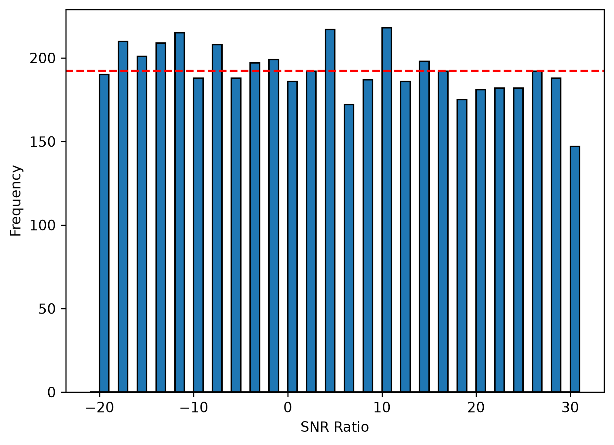
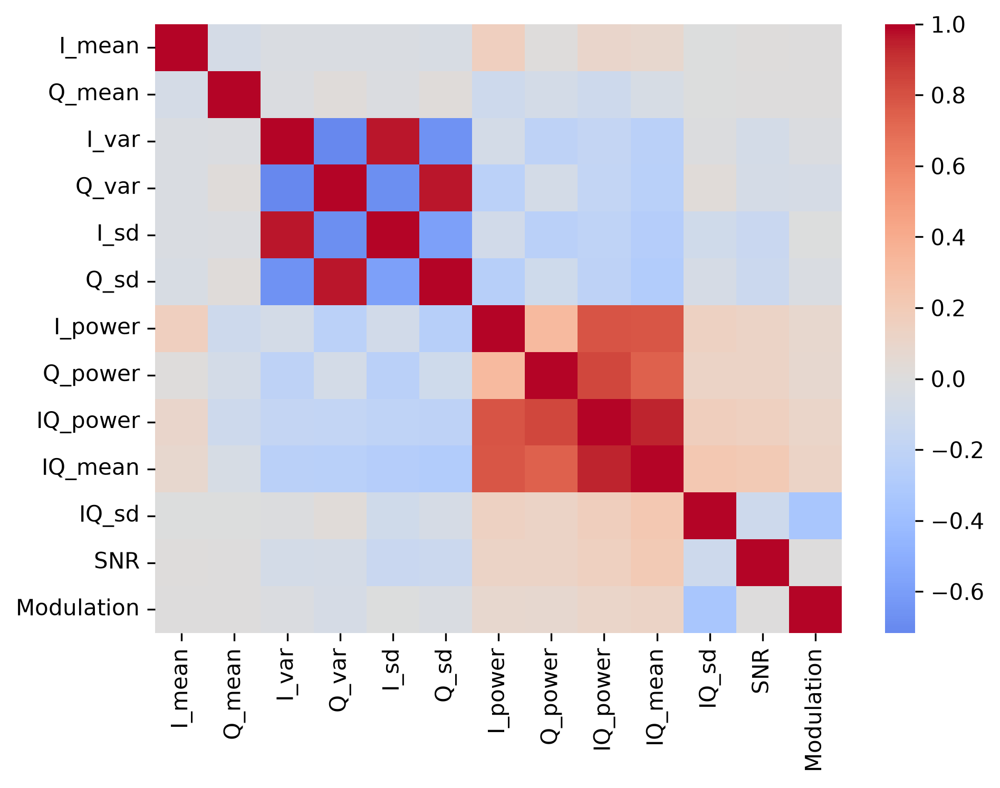
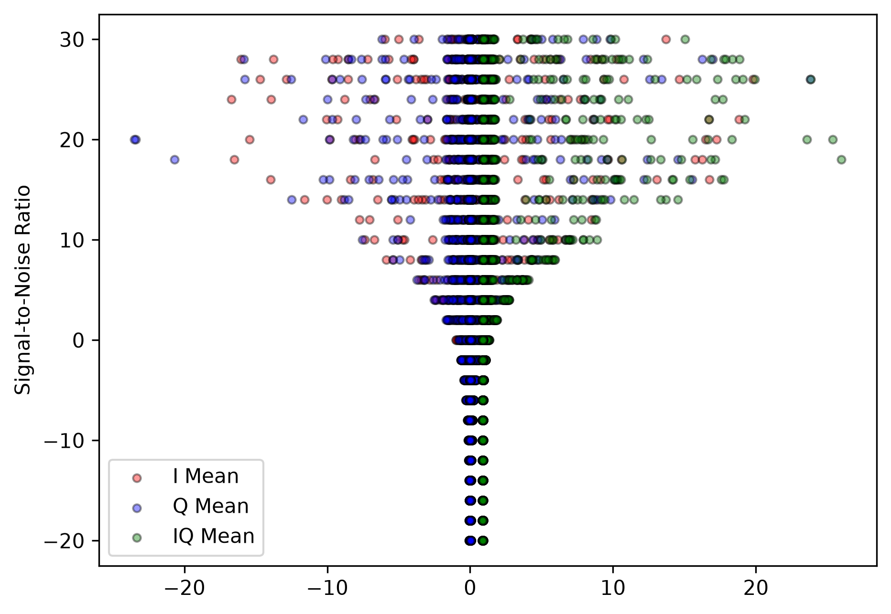

# Why Signal Confidence Matters

- Modern drones and communication systems depend on reliable **radio-frequency (RF) links**.
- Jamming and interference can degrade those links.
- An SNR estimate is useful—but understanding the **uncertainty around that estimate** is also important.

::: {.callout-important}
**The challenge:** A prediction is more informative when we also understand how reliable it may be.
:::

# Research Question

- How effectively can a Bayesian neural network predict signal-to-noise ratio (SNR) from signal-derived features, and can predictive uncertainty help characterize those predictions?

**Our objective**

- Develop and evaluate a Bayesian neural network that predicts SNR while estimating predictive uncertainty.
 
# The Data: RadioML 2018.01A

::: {.columns}
::: {.column width="58%"}
- Simulated RF signals from DeepSig's RadioML 2018.01A dataset.
- Random sample of **5,000 signal frames**.
- **24 modulation types**.
- **26 SNR levels**, from −20 dB to +30 dB.
:::
::: {.column width="42%"}
::: {.callout-note}
### Each signal frame

**1,024**

in-phase (I) and quadrature (Q) measurements
:::
:::
:::

## Data Preparation and Predictor Selection

::: {.columns}

::: {.column width="50%"}
### Dataset and sample

- RadioML 2018.01A: 2,555,904 signal frames
- Random sample: **5,000 frames**
- 1,024 I/Q measurements per frame
- 24 modulation types and 26 SNR levels
:::

::: {.column width="50%"}
### Preparation

- Summarized I/Q measurements using means, variability, and power features
- Checked for missing values and reviewed feature distributions
- Retained extreme power values as potentially valid signal conditions
- Standardized numeric predictors using training-set means and SDs
:::

:::

::: {.callout-note}
**Predictor selection:** `IQ_Power` was removed because it is exactly redundant: `IQ_Power = I_Power + Q_Power`. Modulation was treated as a categorical predictor.
:::

## Bayesian Neural Network and Probability Model

::: {.columns}

::: {.column width="50%"}
### Network Architecture

- Five hidden layers with ReLU activation
- TensorFlow Probability `DenseFlipout` layers
- Normal(0, 1) weight priors
- Gaussian output with predicted mean (μ) and standard deviation (σ)
:::

::: {.column width="50%"}
### Probability Model

- Models SNR as a predictive distribution
- Gaussian likelihood for observed SNR
- Negative log-likelihood (NLL) loss
- Adam optimizer
:::

:::

::: {.callout-tip}
**Key distinction:** Rather than returning only one SNR estimate, the network estimates a distribution representing the prediction and its spread.
:::

## Training, Validation, and Evaluation

::: {.columns}
::: {.column width="33%"}
::: {.callout-note}
### Data partition

- 70% training
- 30% held-out testing
- 20% of training data used for validation
:::
:::
::: {.column width="33%"}
::: {.callout-note}
### Model training

- 200 epochs
- Adam optimizer
- Validation monitored during training
:::
:::
::: {.column width="33%"}
::: {.callout-note}
### Evaluation

- Mean squared error (MSE)
- Mean absolute error (MAE)
- Predictive uncertainty
:::
:::
:::

**Prediction procedure:** 200 stochastic prediction passes were used to generate predictive distributions; the resulting predictions were combined for the final summaries.

# What the Data Revealed

::: {.columns}
::: {.column width="50%"}
### SNR and modulation

SNR distribution across the sampled signal frames.

:::
::: {.column width="50%"}
### Feature relationships

Relationships among the signal-derived predictors.

:::
:::

# Signal Characteristics

::: {.columns}
::: {.column width="50%"}
### Signal means

:::
::: {.column width="50%"}
### Signal power

:::
:::

# How Well Did the Model Predict SNR?

::: {.columns}
::: {.column width="33%"}
### Training loss

.png)
:::
::: {.column width="33%"}
### MAE

:::
::: {.column width="33%"}
### MSE

:::
:::

**Test-set performance**

- **RMSE:** 4.16 dB
- **MAE:** [Insert final test MAE]

# What Does Predictive Uncertainty Tell Us?

**A Bayesian model provides more than a single SNR estimate.**

- **Aleatoric uncertainty:** variation associated with the observations and signal conditions.
- **Epistemic uncertainty:** uncertainty associated with what the model has learned.
- **Predictive uncertainty:** combines both sources.

\[
\operatorname{Var}(Y\mid x,\mathcal{D})
=
\mathbb{E}_{w}\!\left[\operatorname{Var}(Y\mid x,w)\right]
+
\operatorname{Var}_{w}\!\left[\mathbb{E}(Y\mid x,w)\right]
\]

# Conclusion: The Takeaway

::: {.takeaway}
**The value of the Bayesian approach is the ability to examine prediction accuracy and uncertainty together.**
:::

- SNR prediction provides an estimate of signal quality.
- Predictive uncertainty adds information about how variable or uncertain that estimate may be.
- This is a potential foundation for further investigation—not a demonstrated real-time electronic-warfare capability.

## Limitations and Next Steps

::: {.columns}
::: {.column width="50%"}
### Limitations

- Random sample of 5,000 simulated frames.
- No real-world RF deployment.
- Results depend on the selected features and model configuration.
:::
::: {.column width="50%"}
### Future work

- Evaluate the full RadioML benchmark.
- Test on additional or out-of-distribution signal conditions.
- Investigate implementation on software-defined radio hardware.
:::
:::

# Final Takeaway

::: {.takeaway}
- A useful SNR prediction is not only about the estimated value—it is also about understanding the uncertainty surrounding it. 
- Our capstone project demonstrates how a Bayesian neural network can be used to predict signal-to-noise ratio from signal-derived features while providing a measure of predictive uncertainty.
- The results highlight the value of considering not only what a model predicts, but also how confident it is in those predictions.

:::

## References
