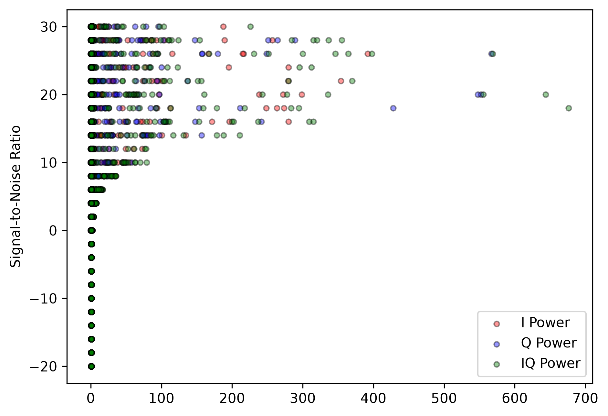
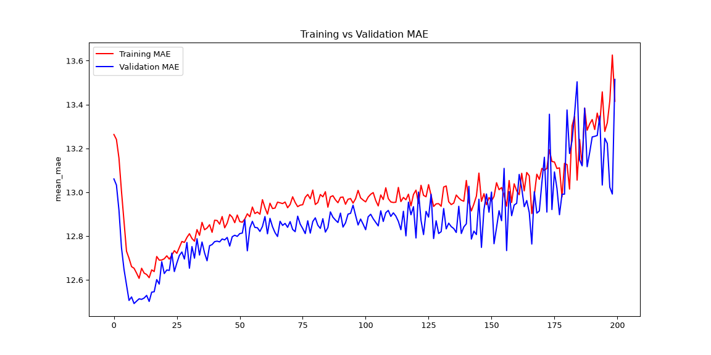
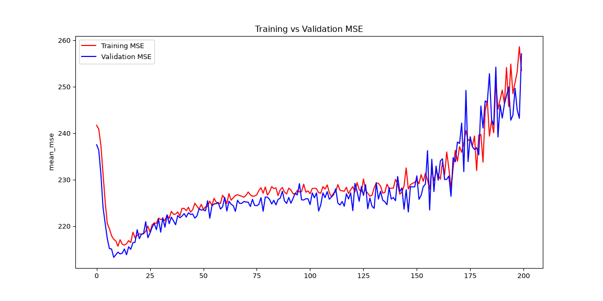

## 1. Operational Motivation: The EW Battleground {data-background-color="#1a1e24" .scrollable .smaller}

::: {.panel-tabset}

## Background and Motivation

- **Electronic Warfare (EW)** has been part of military operations since World War I, evolving alongside communications technology
  - Protects aircraft and pilots in contested environments
  - Jamming can disrupt communications and operational effectiveness
  ([Electronic Warfare, n.d.](https://jdilena1999.github.io/IDC6940_BayesianNeuralNetworks/#ref-noauthor_under_nodate))

- **Modern military drones** increasingly depend on reliable radio-frequency (RF) links
  - Vulnerable to jamming and signal interference
  ([vgi_admin, 2025](https://jdilena1999.github.io/IDC6940_BayesianNeuralNetworks/#ref-vgi_admin_drones_2025))

- **Machine learning applications in wireless security**
  - Jere et al. (2024) combined supervised learning and Bayesian network inference
  - Demonstrated near-real-time jamming detection and classification
  ([Jere et al., 2024](https://jdilena1999.github.io/IDC6940_BayesianNeuralNetworks/#ref-10352089))

## Dataset: RadioML 2018.01A

- Created by DeepSig Inc.; accessed through Kaggle
  ([DeepSig Inc., 2018])

- Simulated RF signals across different modulation types and noise levels
  ([O'Shea et al., 2018])

- **Full dataset characteristics:**
  - 2,555,904 signal frames
  - 24 modulation types
  - 26 SNR levels (-20 dB to +30 dB)
  - 1,024 in-phase and quadrature (I/Q) samples per signal

- **Research sample:**
  - Random subsample of N = 5,000 signal frames

- Provides a framework for examining how signal quality changes under varying noise conditions
  ([O'Shea et al., 2018])

## Research Objective

- Model **Signal-to-Noise Ratio (SNR)** as the response variable using neural networks and Bayesian analysis

- Bayesian methods:
  - Treat model parameters as probability distributions rather than fixed values
  - Incorporate prior knowledge
  - Allow results to be expressed as probability statements
  ([Berger, 2000])

- **Bayesian Neural Networks (BNNs):**
  - Provide a framework for addressing overfitting
    ([Bishop, 1997](https://jdilena1999.github.io/IDC6940_BayesianNeuralNetworks/#ref-Bishop1997))
  - Quantify predictive uncertainty, particularly useful with noisy data
    ([Mullachery et al., 2018])
  - Require consideration of scalability with large datasets
    ([Jospin et al., 2022](https://jdilena1999.github.io/IDC6940_BayesianNeuralNetworks/#ref-9756596))
  - Bayesian priors provide a form of regularization comparable to weight decay
    ([Bishop, 1997])

::: 

## Bayesian Neural Network and Probability Model

::: {.columns}

::: {.column width="50%"}
### Network Architecture

- Five hidden layers with ReLU activation
- TensorFlow Probability `DenseFlipout` layers
- Normal(0, 1) weight priors
- Gaussian output with predicted mean (μ) and standard deviation (σ)
:::

::: {.column width="50%"}
### Probability Model

- Models SNR as a predictive distribution
- Gaussian likelihood for observed SNR
- Negative log-likelihood (NLL) loss
- Adam optimizer
:::

:::

::: {.callout-tip}
**Key distinction:** Rather than returning only one SNR estimate, the network estimates a distribution representing the prediction and its spread.
:::

## Training, Validation, and Evaluation

::: {.columns}
::: {.column width="33%"}
::: {.callout-note}
### Data partition

- 70% training
- 30% held-out testing
- 20% of training data used for validation
:::
:::
::: {.column width="33%"}
::: {.callout-note}
### Model training

- 200 epochs
- Adam optimizer
- Validation monitored during training
:::
:::
::: {.column width="33%"}
::: {.callout-note}
### Evaluation

- Mean squared error (MSE)
- Mean absolute error (MAE)
- Negative Log-Loss
:::
:::
:::

**Prediction procedure:** 200 stochastic prediction passes were used to generate predictive distributions; the resulting predictions were combined for the final summaries.

## What the Data Revealed

::: {.columns}
::: {.column width="50%"}
### SNR and modulation

SNR distribution across the sampled signal frames.

:::
::: {.column width="50%"}
### Feature relationships

Relationships among the signal-derived predictors.

:::
:::

## Signal Characteristics

::: {.columns}
::: {.column width="50%"}
### Signal means

:::
::: {.column width="50%"}
### Signal power

:::
:::

## How Well Did the Model Predict SNR?

::: {.columns}
::: {.column width="33%"}
### Training loss

.png)
:::
::: {.column width="33%"}
### MAE

:::
::: {.column width="33%"}
### MSE

:::
:::

**Training and Validation performance**

- During model training, our model was successful in minimizing our loss function (Negative Log-Loss)

# What Does Predictive Uncertainty Tell Us?

**A Bayesian model provides more than a single SNR estimate.**

- **Aleatoric uncertainty:** variation associated with the observations and signal conditions.
- **Epistemic uncertainty:** uncertainty associated with what the model has learned.
- **Predictive uncertainty:** combines both sources.

$$
\sigma_{\text{total}}(x) = \sqrt{\underbrace{\frac{1}{T}\sum_{t=1}^{T}\left(\mu_t(x) - \bar{\mu}(x)\right)^2}_{\text{epistemic}} + \underbrace{\frac{1}{T}\sum_{t=1}^{T}\sigma_t^2(x)}_{\text{aleatoric}}}
$$

## Conclusion

::: {.panel-tabset}

## The Takeaway

**The value of the Bayesian approach is the ability to examine prediction accuracy and uncertainty together.**

- SNR prediction provides an estimate of signal quality.
- Predictive uncertainty adds information about how variable or uncertain that estimate may be.
- This is a potential foundation for further investigation—not a demonstrated real-time electronic-warfare capability.

## Limitations and Next Steps

<!-- {.columns}
# {.column width="50%"}
### Limitations
-->
- Random sample of 5,000 simulated frames.
- No real-world RF deployment.
- Results depend on the selected features and model configuration.

## Future work

- Evaluate the full RadioML benchmark.
- Test on additional or out-of-distribution signal conditions.
- Investigate implementation on software-defined radio hardware.

:::

# Final Takeaway

::: {.takeaway}
- A useful SNR prediction is not only about the estimated value—it is also about understanding the uncertainty surrounding it. 
- Our capstone project demonstrates how a Bayesian neural network can be used to predict signal-to-noise ratio from signal-derived features while providing a measure of predictive uncertainty.
- The results highlight the value of considering not only what a model predicts, but also how confident it is in those predictions.

:::

## References
